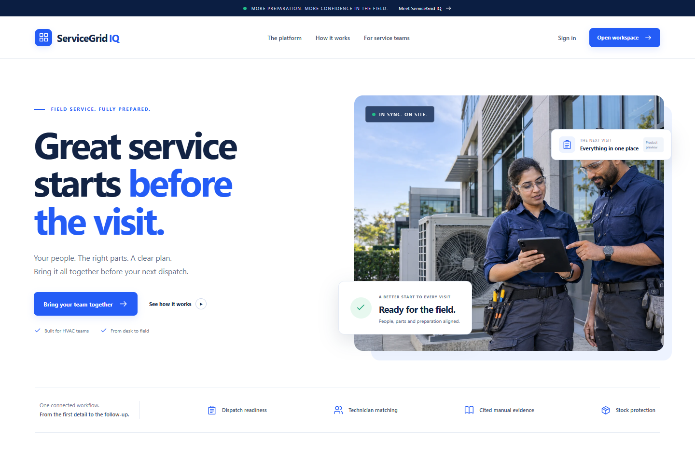
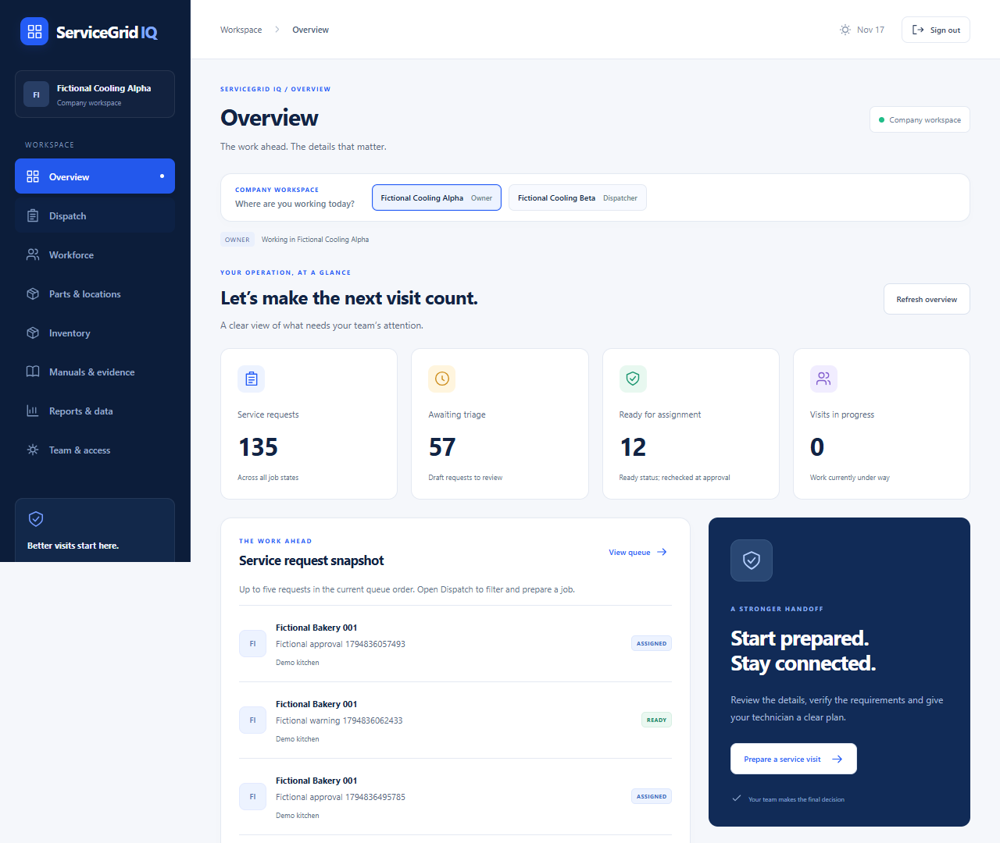
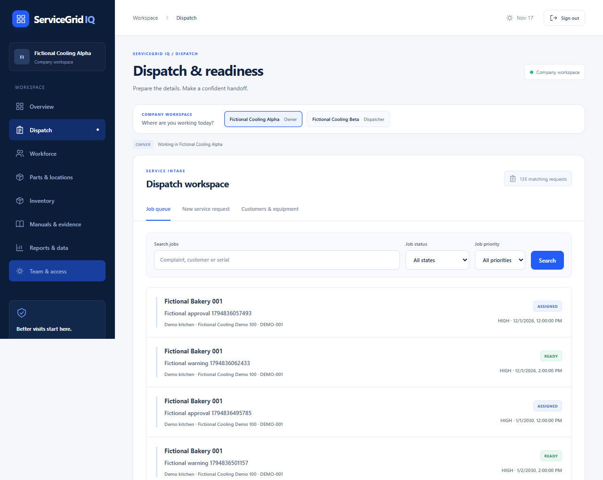
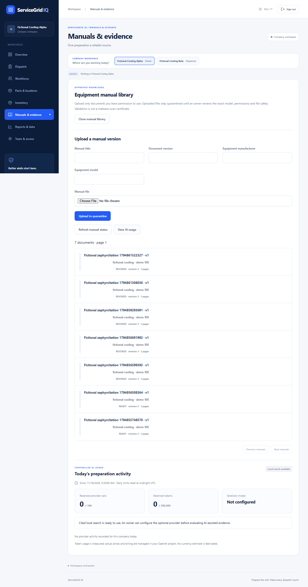
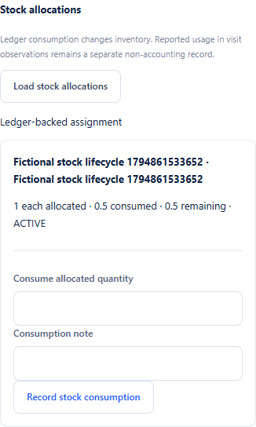
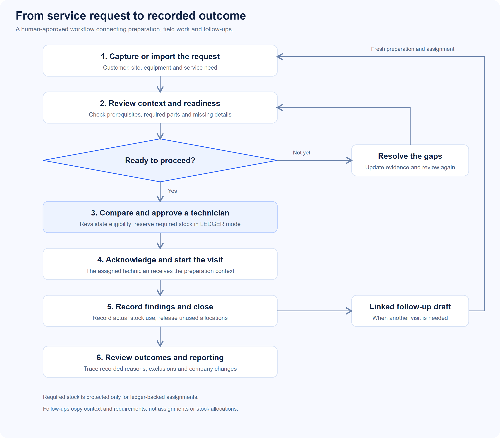
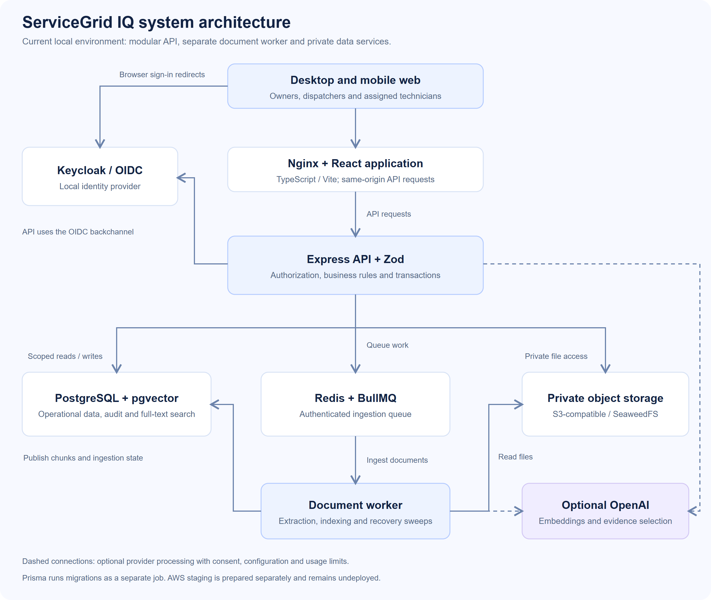

<div align="center">

# ServiceGrid IQ

### A more prepared visit. A more connected service operation.

Dispatch readiness, technician workflows, cited manual evidence and protected parts inventory for HVAC service teams.

[](https://github.com/saikoushikpallapolu/ServiceGridIQ/actions/workflows/ci.yml)
[](https://github.com/saikoushikpallapolu/ServiceGridIQ/actions/workflows/docs.yml)

[](LICENSE)

[Product overview](#why-servicegrid-iq) · [Screenshots](#inside-the-product) · [Architecture](#system-architecture) · [Run locally](#run-the-mvp-locally) · [Business inquiries](#evaluate-servicegrid-iq-for-your-team)

</div>



**ServiceGrid IQ is a working, end-to-end MVP for preparing and executing field-service visits.** It connects the office and the field through a practical workflow: capture the job, verify readiness, approve the right technician, protect required parts and record the outcome.

> **Current availability:** functional locally through Docker Compose, with a responsive desktop and mobile web interface. Core workflows and the optional knowledge/inventory extensions are implemented and verified. Public hosting, customer pilots and live paid-provider evaluation are the next validation steps.

## Why ServiceGrid IQ?

A job can be on the schedule and still be poorly prepared.

Missing equipment details, an unverified qualification, an unavailable part or an unclear handoff can surface only after a technician reaches the site. ServiceGrid IQ gives teams a place to resolve those gaps **before assignment**, then carry that preparation through the visit and any follow-up.

| Operational challenge | What ServiceGrid IQ provides |
| --- | --- |
| Job information lives across disconnected records | A linked customer, site, equipment and service-request history |
| Dispatchers need to know what is missing | Explicit readiness checks, prerequisites, blockers and acknowledged warnings |
| Technician selection relies on incomplete context | Eligibility checks and explainable ranking using recorded qualifications and availability |
| The same stock can be promised to competing jobs | Optional transactional reservations for confirmed required parts |
| Field teams receive an incomplete handoff | Assigned visit cards with preparation context, evidence and outcome capture |
| Repeat visits are difficult to investigate | Linked follow-ups, recorded reasons and descriptive operational reporting |

The intended business outcome is fewer preventable preparation gaps and clearer accountability. **Customer ROI, revisit reduction and willingness to pay have not yet been established through a live pilot.**

### Who it is built for

- **Commercial HVAC and AC maintenance teams** coordinating service jobs across technicians and locations.
- **Owners and service managers** who need visibility into preparation, recorded outcomes and stock changes.
- **Dispatchers** who need a defensible assignment decision, rather than another unstructured checklist.
- **Technicians** who need the relevant job context on a phone at the point of work.

The initial customer segment is a service business with approximately **5–30 technicians**. Suitability for larger operations requires representative workload and operating validation.

### Where it fits in an existing operation

ServiceGrid IQ focuses on the preparation-to-outcome workflow. Reviewed CSV onboarding and controlled exports provide a practical starting point for evaluating it alongside existing records.

It does not currently replace accounting, invoicing, payments, payroll or customer communications platforms. Direct synchronization with commercial field-service systems requires a separately scoped integration with confirmed vendor access and data ownership rules.

## Inside the product

Actual application screenshots below use fictional local demonstration records. Counts are sample operational data, not customer adoption or performance claims. Landing-page technician photography is AI-generated; [image provenance and design details](docs/design/frontend-redesign.md) are documented.

### An operational overview with real workspace data

Owners and dispatchers can inspect service-request counts, draft work awaiting triage, ready requests and visits in progress, then move into the relevant workflow.



### A dispatch workspace built around preparation

Search and filter requests, review equipment and site context, resolve preparation gaps, compare eligible technicians and approve assignments. The server rechecks current conditions before committing an assignment.



<details>
<summary><strong>View the private manual library and mobile stock workflow</strong></summary>

#### Reviewed knowledge, traceable evidence

Owners upload and review manuals before indexing. Evidence is scoped to the company, equipment model and current approved document revision. Dispatchers and authorized technicians can verify the underlying source.



#### Stock consumption from the field

An assigned technician can record consumption against protected quantities. Safe retries prevent a committed request from deducting stock twice when its response is lost.



The technician interface is responsive, online mobile web. Native and offline applications are outside the current MVP.

</details>

## The complete service workflow



In LEDGER mode, assignment also reserves confirmed required stock within the same transaction. Closure releases unused quantities. A follow-up draft receives context and requirements, rather than inheriting a technician assignment or stock allocation.

## Implemented capabilities

| Product area | Available in the MVP |
| --- | --- |
| **Company workspaces and access** | OIDC sign-in, server-side sessions, company selection, owner/dispatcher/technician roles, invitations, membership management and audit |
| **Customer and asset context** | Customers, service sites, equipment records, versioned intake, filtering, triage, timelines and equipment service-request history |
| **Workforce and scheduling** | Branches, technician profiles, owner-verified qualifications, explicit shifts/unavailability, estimated work duration, travel buffers and appointment eligibility |
| **Dispatch readiness** | Required and suspected parts, prerequisites, timestamped manual evidence, blockers, acknowledged warnings, deterministic ranking and human-approved assignments |
| **Technician execution** | Assigned visit cards, acknowledgment, start, notes and observations, closure, linked follow-up drafts, cancellation and pre-start rescheduling |
| **Stock accounting** | Optional ledger mode, balances by part/location, atomic reservations, actual consumption, receipts, bounded returns, corrections, physical counts and reconciliation |
| **Manual knowledge** | Private PDF/text uploads, quarantine/review/revocation, background extraction and indexing, current-source citations and optional OpenAI-assisted evidence selection |
| **Onboarding and reporting** | Reviewed CSV imports, validation errors, safe commit retries, controlled exports, descriptive reports, explicit exclusions and paginated audit history |
| **Operational foundation** | Health checks, private aggregate metrics, encrypted database restore rehearsals, exact-image recreation, local load checks and automated CI |

### Clear responsibilities for each role

| Role | Primary workspace responsibilities |
| --- | --- |
| **Owner** | Manage people and permissions, workforce records, manual approvals, stock movements and mode, onboarding, exports and reporting |
| **Dispatcher** | Capture and triage requests, prepare jobs, inspect eligibility, approve assignments and manage supported visit lifecycle actions |
| **Technician** | Access authorized assignments, review preparation evidence, acknowledge/start visits, record findings and consumption, and close visits |

Permissions are enforced by the API. Hiding an interface control is not the authorization boundary.

## What makes the implementation distinct

### Readiness is part of the assignment decision

The system distinguishes missing requirements, blocking conditions and warnings that need an explicit acknowledgment. A dispatcher sees the reasoning and makes the final decision. Eligibility and stock are revalidated when the assignment is approved.

### Inventory protection is transactional

In LEDGER mode, required-part allocations and the technician assignment commit together. Concurrent approvals cannot both claim the last available item. Receipts and consumption use version checks and idempotency keys; cancellations, rescheduling and closure release unused allocations.

MANUAL mode remains available. Existing manual assignments are not silently converted into protected stock commitments when ledger mode is enabled.

### Knowledge remains attributable and advisory

Search filters approved sources by company, equipment manufacturer/model and document revision. Source access is rechecked when a citation is opened. Optional AI output selects validated source quotations with uncertainty and gaps; it cannot assign technicians, approve readiness or change inventory.

### Follow-ups remain connected to the original visit

A follow-up is a linked service request with a recorded reason. It enters its own preparation and assignment process, giving managers a basis for investigation rather than an untraceable duplicate job.

## System architecture

ServiceGrid IQ uses a **modular monolith with a separate background worker process**. The API owns business rules and transactional operations; the worker handles document ingestion. The worker runs from the API codebase and image, rather than being an unimplemented future service.



**Reading the architecture:**

1. Nginx serves the React app and proxies same-origin API requests. Sign-in uses local Keycloak and an opaque server-side session.
2. Express validates shared Zod contracts and enforces company, role and assignment access before applying business rules.
3. PostgreSQL stores operational records, audit, allocations, movements and document metadata/chunks. Reviewed SQL supplements Prisma with database-specific constraints and search features.
4. Private object storage holds uploaded files. Redis/BullMQ coordinates ingestion; persisted queue intent and worker sweeps support recovery from enqueue failures.
5. Local cited search works without an AI provider. Consented OpenAI processing is an optional extension with usage reservations and daily limits.

AWS staging configuration exists separately from this local architecture. It has not been deployed or verified as a hosted production environment.

### Technology stack

| Layer | Implementation |
| --- | --- |
| Interface | React, TypeScript, Vite, shared blue/white/navy design system |
| API | Node.js, Express, Zod |
| Persistence | PostgreSQL 17, Prisma 7.10.1, reviewed SQL constraints |
| Identity | Keycloak locally, OpenID Connect, server-side sessions |
| Background processing | Redis, BullMQ, separate document worker |
| Document storage | Private S3-compatible storage, SeaweedFS locally |
| Retrieval | PostgreSQL full-text search, pgvector, exact-model/source filtering |
| Optional AI | OpenAI embeddings and structured evidence selection |
| Delivery and checks | Docker Compose, GitHub Actions, Vitest, Playwright |

Node.js **24.19.0** and pnpm **11.25.0** are pinned. The repository includes a committed dependency lockfile and executable phase-specific API contracts.

## Reliability, access control and engineering evidence

- **Company isolation:** server-side scope checks and tenant-safe relationships protect operational and document records.
- **Current access checks:** membership, role and technician assignment scope are enforced on relevant requests; withdrawn assignments lose access.
- **Safe mutations:** version checks, assignment binding, idempotency keys and transactions protect supported workflows against stale edits and duplicate retries.
- **Auditable changes:** attributed operational events and stock movements support investigation. Stock movement UPDATE is blocked; this does not make the database tamper-proof against privileged administrators.
- **Private knowledge:** reviewed sources, authorized downloads, current-revision citation checks and bounded PDF extraction. File validation is not antivirus certification.
- **Controlled AI:** provider access is optional, document consent and request opt-in are explicit, usage is tracked and failures fall back to labelled local evidence.
- **Recovery evidence:** encrypted PostgreSQL backup/restore drills verify restored counts and stock reconciliation in a separate database; image recreation rehearsals preserve the database.

### Verification snapshot

The [verified frontend implementation](https://github.com/saikoushikpallapolu/ServiceGridIQ/actions/runs/43952206956) passed **167 automated tests**:

| Test layer | Passed | Examples of covered behavior |
| --- | ---: | --- |
| Unit / protocol | 50 | Policy behavior, bounded extraction and provider protocol handling |
| PostgreSQL integration | 98 | Authorization, tenancy, lifecycle transactions, stock races, safe retries and source filtering |
| Real-container browser | 19 | OIDC, role workflows, mobile layouts, manual ingestion, reports, stock consumption and navigation |

CI also builds the application, checks types/lint and generated contracts, audits production dependencies, starts the full container stack, smoke-tests it and rehearses recovery/load checks. These results describe the referenced implementation; the workflow badges above show current repository status.

A separate local queue rehearsal used **10,000 fictional jobs**, **300 requests** and **10 concurrent clients**, returning 300 HTTP 200 responses with **118 ms p95** in the recorded run. This is a local filtered-queue read benchmark, not a production SLA or a capacity claim for every workload. See the [inventory verification record](docs/plans/phase-10-checklist.md) and [operations runbook](docs/operations/phase-8-runbook.md).

## Run the MVP locally

### Prerequisites

- Git, Node.js 24.19.0 and pnpm 11.25.0.
- Docker Desktop with its Linux engine running, or a compatible Docker Compose environment.
- Available local ports for the web app, identity provider, database, Redis and object storage. See [local development](docs/operations/local-development.md) for configuration.

### Start the complete application

```sh
git clone https://github.com/saikoushikpallapolu/ServiceGridIQ.git
cd ServiceGridIQ

npm install --global pnpm@11.25.0
pnpm install --frozen-lockfile
pnpm setup:env
pnpm db:generate

docker compose --env-file .env -f infrastructure/compose.yaml up -d --build --wait --wait-timeout 240
docker compose --env-file .env -f infrastructure/compose.yaml run --rm migrate pnpm --filter @servicegrid/api db:seed

pnpm smoke
```

Open **[http://localhost:8080](http://localhost:8080)**, choose **Sign in**, then select a company. Use `localhost` for the OIDC browser flow.

Setup generates fictional local account passwords in the ignored `.data/local-accounts.json` file. Passwords and keys are not published in this repository. The [sign-in guide](docs/operations/phase-2-local.md) lists demonstration roles and account setup.

No OpenAI key is needed for the core workflow or local cited search. Optional provider configuration is documented in the [knowledge walkthrough](docs/operations/phase-9-local.md); enter keys locally, never in Git or public messages.

### Recommended demonstration path

1. **Owner:** open Overview, inspect company data, then review Workforce and Parts & locations.
2. **Dispatcher:** open Dispatch, create or select a request, review readiness, compare eligible technicians and approve an assignment.
3. **Technician:** use My visits on a phone-sized screen, acknowledge/start the visit, inspect preparation and record the outcome.
4. **Inventory extension:** initialize appropriate balances, review legacy commitments and enable ledger mode; demonstrate protected assignment, consumption and unused-stock release.
5. **Knowledge extension:** upload a permitted manual, approve/index it and verify cited evidence against an applicable job.
6. **Owner:** inspect follow-up reasons, descriptive reports and audit history in Reports & data.

Use the linked walkthroughs below for prerequisites and complete step-by-step exercises. The local identity provider and generated demonstration credentials are for development, not public deployment.

### Useful engineering commands

```sh
pnpm build              # Build contracts, API and frontend
pnpm typecheck          # Check workspace TypeScript
pnpm lint               # Run lint checks
pnpm test               # Unit / protocol tests
pnpm test:integration   # Requires configured, migrated PostgreSQL
pnpm smoke              # Requires the running local container stack
pnpm check:docs         # Validate documentation files and references
```

For browser checks, install Chromium with `pnpm exec playwright install chromium`, then run `pnpm test:browser` against the running, seeded local stack. Documentation checks verify artifacts and references; they are not substitutes for application tests.

## Repository structure

```text
apps/
  web/                        React interface and public website
  api/
    prisma/                   Schema, migrations and seed data
    src/
      auth/                   Identity, sessions and company access
      intake/                 Customers, assets and service intake
      scheduling/             Workforce and appointment eligibility
      dispatch/               Readiness, ranking and assignment
      visits/                 Technician execution and outcomes
      inventory/              Balances, allocations and stock movements
      knowledge/              Private manuals, retrieval and worker entry point
      onboarding/             Reviewed CSV, exports and descriptive reporting
packages/
  contracts/                  Shared Zod schemas and TypeScript types
infrastructure/
  compose.yaml                Complete local environment
  aws/                        Prepared staging configuration
  monitoring/                 Alert-rule definitions
scripts/                      Setup, smoke, contract and recovery helpers
tests/browser/                End-to-end user workflows and design checks
docs/                         Architecture, APIs, walkthroughs and verification
.github/workflows/            Application/documentation CI and manual staging workflow
```

## Technical documentation

| Reference | What it explains |
| --- | --- |
| [Documentation index](docs/README.md) | Full reading guide and implementation records |
| [Product and engineering blueprint](docs/architecture/ServiceGrid_IQ_Build_Blueprint_v2.md) | Product boundaries, lifecycle, architecture and original design decisions |
| [Frontend design record](docs/design/frontend-redesign.md) | Workspace navigation, image provenance, design checks and verified CI |
| [Intake walkthrough](docs/operations/phase-3-local.md) | Customers, sites, equipment, requests and triage |
| [Workforce walkthrough](docs/operations/phase-4-local.md) | Qualifications, shifts and eligibility |
| [Dispatch walkthrough](docs/operations/phase-5-local.md) | Preparation, readiness, ranking and approved assignment |
| [Technician workflow](docs/operations/phase-6-local.md) | Visits, closure, cancellation, rescheduling and follow-ups |
| [Data and reporting](docs/operations/phase-7-local.md) | CSV review/commit, exports, exclusions and audit |
| [Operating and recovery runbook](docs/operations/phase-8-runbook.md) | Metrics, restoration, recovery rehearsals and hosted operating gates |
| [Manual knowledge walkthrough](docs/operations/phase-9-local.md) | Private ingestion, citations, optional AI and source limitations |
| [Stock ledger walkthrough](docs/operations/phase-10-local.md) | Reservations, consumption, returns, reconciliation and mode transition |

Implemented API contracts are available for [authentication](docs/api/phase-2-openapi.json), [intake](docs/api/phase-3-openapi.json), [scheduling](docs/api/phase-4-openapi.json), [dispatch](docs/api/phase-5-openapi.json), [visits](docs/api/phase-6-openapi.json), [data/reporting](docs/api/phase-7-openapi.json), [knowledge](docs/api/phase-9-openapi.json) and [inventory](docs/api/phase-10-openapi.json).

The original blueprint and proposed pilot contract describe design intent. Implemented contracts, current walkthroughs and verification records take precedence when assessing what runs today.

## Current scope and next milestones

| Implemented and demonstrated | Next validation / separately scoped work |
| --- | --- |
| Complete local service-request-to-outcome workflow | Hosted staging, managed identity, TLS and public deployment |
| Multi-company roles and authorized technician workflows | Named pilot partner, shadow operation and measured customer outcomes |
| Optional transactional stock ledger | Purchasing, costing, transfers and vendor synchronization |
| Private manual ingestion and cited retrieval | Real paid OpenAI evaluation against permitted customer manuals |
| Responsive online mobile web | Native applications and offline synchronization |
| Local metrics, restore/image/load rehearsals | Offsite backup/key custody, delivered alerts and hosted recovery validation |

No customer adoption statistics, revenue results, security certification or production uptime guarantee are claimed by this repository.

## Evaluate ServiceGrid IQ for your team

For companies exploring a pilot, workflow adaptation or product acquisition discussion, the next step is a focused review of the **preparation and handoff problem** in your operation.

A useful evaluation starts with:

- Your service categories, technician count and dispatch process.
- Where missing information, parts or qualifications create friction today.
- Your current systems and the records you can export for a controlled evaluation.
- A small set of agreed pilot measures, such as preparation gaps caught, recorded follow-up reasons and dispatcher review effort.

For evaluation inquiries, use the contact information available on the [GitHub profile](https://github.com/saikoushikpallapolu).

## License

Distributed under the [MIT License](LICENSE). Customer records, proprietary equipment manuals and third-party materials are not covered by the repository license.

## Product demo

A recorded product walkthrough will be added here. Until then, use the screenshots, implemented walkthroughs and local setup above to explore the MVP.

<!-- Add the demo video link or linked thumbnail here when the recording is ready. -->
